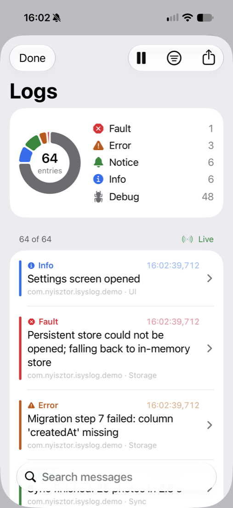

# iSyslogKit

An in-app log console for iOS apps. See your app's logs on the device, filter them by severity, and share them as a file that testers can attach to a bug report.



- **Captures your app's own logs:** `Logger` and `os_log` messages, plus `print` output, which still shows up in Xcode's console as before.
- **A console you can drop into any SwiftUI app:** severity summary with a chart, search, level/subsystem/category filters, and entry details.
- **Shareable sessions:** testers tap Share and send a `.isyslog` file by AirDrop, Mail or Messages. The free **iSyslog** app opens it on iPhone and iPad.
- **Off in App Store builds by default:** it only captures in Debug builds and TestFlight installs.
- **Public APIs only.** iOS 17+, macOS 14+, Swift 6.

## Installation

Add the package in Xcode (File ▸ Add Package Dependencies…) with this URL:

```
https://github.com/nyisztor/iSyslogKit
```

Or in `Package.swift`:

```swift
.package(url: "https://github.com/nyisztor/iSyslogKit", from: "0.1.0")
```

Then link the `iSyslogKit` product to your app target.

## Usage

Start it once at launch, and show the console wherever you like:

```swift
import iSyslogUI   // the console, plus everything in iSyslogKit

@main struct MyApp: App {
    init() { ISyslog.start() }
    var body: some Scene {
        WindowGroup {
            ContentView()
                .isyslogConsoleOnShake()   // optional: shake the device to open the console
        }
    }
}

struct ContentView: View {
    @State private var showsLogs = false
    var body: some View {
        Button("Logs") { showsLogs = true }
            .isyslogConsole(isPresented: $showsLogs)   // or embed ISyslogConsole() directly
    }
}
```

Log as usual with `Logger`; there's no iSyslogKit-specific logging API to adopt.

### Sharing from your own UI

A "Report a Problem" button can share the session without opening the console:

```swift
Button("Report a Problem") {
    Task { try? await ISyslogShareSheet.shareCurrentSession() }
}
```

### Debug messages and private values

Apps can't read their own `Logger.debug` messages or private values (`\(value)` without `privacy: .public` shows as `<private>`) unless the app opts in through its Info.plist:

```xml
<key>OSLogPreferences</key>
<dict>
  <key>com.example.myapp</key>   <!-- your Logger subsystem -->
  <dict><key>DEFAULT-OPTIONS</key><dict>
    <key>Level</key><dict><key>Enable</key><string>Debug</string><key>Persist</key><string>Debug</string></dict>
    <key>Enable-Private-Data</key><true/>
  </dict></dict>
</dict>
```

> [!WARNING]
> Don't ship `Enable-Private-Data` to the App Store. Use a separate Info.plist (or build setting) for your Debug and TestFlight configurations.

### Configuration

```swift
ISyslog.start(.init(
    activation: .debugAndTestFlightBuilds,  // or .always, .debugBuilds, .never
    bufferCapacity: 10_000,                 // entries kept in memory
    pollInterval: .seconds(3),              // refresh rate while a console is visible
    capturesStandardOutput: true,           // print()
    capturesStandardError: false            // under Xcode, stderr repeats your Logger output
))
```

### Without the UI

```swift
if let capture = ISyslog.capture {
    try await capture.refresh()
    let problems = LogFilter(levels: [.error, .fault]).apply(to: await capture.entries)
    let file = try await capture.exportSession()   // URL of a .isyslog file
}
```

## What it captures, and what it costs

- **Captured:** your app's unified-log messages, `print` output, and messages Apple's frameworks log inside your process. The console hides Apple's messages unless you turn them on in its filter menu.
- **Not captured:** other processes' logs. iOS doesn't allow it. Only the current launch is available.
- **Cost:** nothing while no console is open. While one is visible, it refreshes every 3 seconds, which measured 0.2–0.6% CPU on an iPhone 15 Pro and an iPad Pro. The first time a console opens, it reads everything logged so far; with 10,000 entries that took about 6 seconds on an iPhone 15 Pro.

## Example

`Example/iSyslogKitDemo.xcodeproj` is a small app that logs like a real one and shows the console. Select your team under Signing & Capabilities to run it on a device.

## License

MIT. See [LICENSE](LICENSE).
